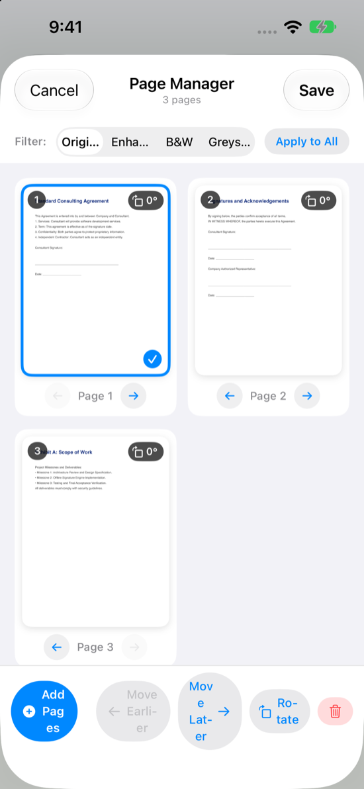
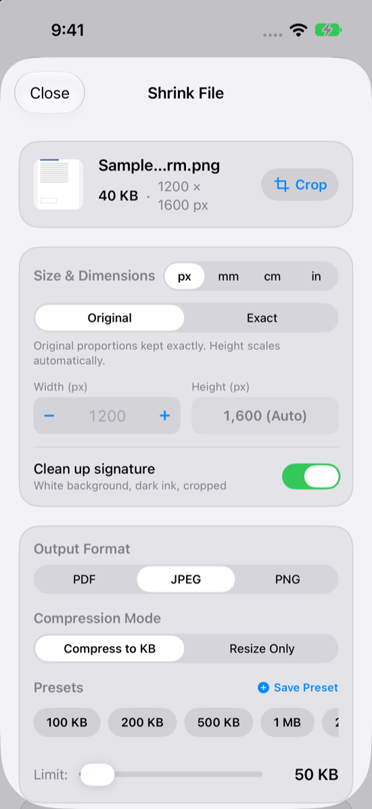
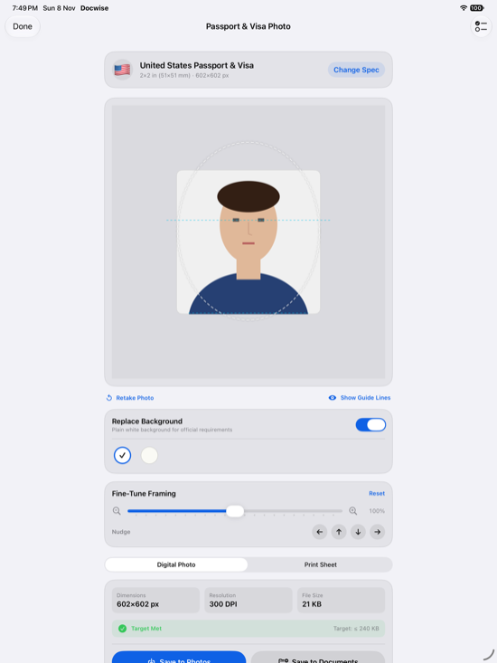

# Docwise: Sign & Shrink PDF
### Sign PDFs, fill forms, scan pages, and shrink files and photos to the exact KB a form asks for

Docwise is the paperwork app for iPhone and iPad. Sign a PDF, fill in a form, scan a document, make a passport or visa photo, and compress a PDF or photo to the size an upload form allows. No account is needed, and scanning, signing and shrinking happen on your device.

  
    Coming soon to the App Store
  
  For iPhone and iPad with iOS 17 or later. The link will appear when the app is released.

  
  
  

---

## What you can do

### Sign & fill PDFs
- Draw your signature with a finger or Apple Pencil, or photograph one on paper and let Docwise clean up the background.
- Keep up to 3 signatures and 3 initials saved for next time.
- Add the date and your own text anywhere on a page.
- Fill PDF form fields: text boxes, checkboxes and drop-downs.
- Export a flattened PDF, so your signature and text become part of the page.

### Shrink PDFs and photos to a target size
- Type the size an upload form asks for, for example 200 KB, and Docwise compresses a PDF or JPEG to fit.
- Or resize to exact pixels, in px, mm, cm or inches.
- A US visa photo preset is built in, and you can save your own presets.

### Passport & visa photos
- Size presets for US passport and visa, US DS-160, UK (printed and digital), Schengen, Japan, Canada, Australia and India.
- Change the background to white, off-white, light grey, cream or light blue.
- Oval face guide, with manual crop, nudge and zoom.
- Print sheets in 4×6 inch or A6 at 300 DPI.
- Export to a file-size limit. Location data is removed from exported photos.

### Scan documents
- Multi-page scanning with automatic edge detection and perspective fix.
- Filters: Original, Enhanced, Black & White and Greyscale.
- Rotate, reorder and delete pages, and add pages from Photos or Files.
- Scan an ID card: front and back on one page at real size, on A4 or Letter.
- Text recognition runs on your device.

### More PDF tools
- Merge photos and PDFs into one PDF.
- Split a PDF by range, by selected pages, or into single pages.
- Redact: draw boxes or search for a word. Redacted pages are re-rendered, so the covered text cannot be copied.

### Fax — coming soon
Send a signed PDF straight to a fax machine in the United States or Canada. This feature is not in the app yet.

### Open it from anywhere
- Share a PDF to Docwise from Mail, Files or Safari to sign or shrink it.
- Open PDFs and images from Files, or drag and drop them on iPad.
- Optional Face ID lock.

---

## Free vs Docwise Pro

Docwise has no free trial. It is a one-task app, so the free tier is the trial: you can try every tool before you pay.

| | Free | Docwise Pro |
|---|:---:|:---:|
| Signed PDF exports | 2 | Unlimited |
| Scans (documents and ID cards) | 5 | Unlimited |
| Shrinks to a target size | 2 | Unlimited |
| No account, no ads, no tracking | Yes | Yes |

Docwise Pro is a monthly or yearly subscription. The price is shown in the app by the App Store for your country. Cancel any time in Settings.

---

## Frequently Asked Questions

### Are my documents uploaded anywhere?
No. Scanning, text recognition, signing, form filling, shrinking, passport photos and the PDF tools all work on your iPhone or iPad. The app has no account and no analytics. See the [Privacy Policy](privacy/) for the one exception, the optional fax feature.

### Can I use Docwise without an internet connection?
Yes for the document tools. An internet connection is only needed to buy or restore a subscription.

### Is a signature added with Docwise legally binding?
Docwise adds your drawn signature to a document. Whether an electronic signature is accepted depends on the person you send it to and on local law. Docwise does not certify or verify signatures.

### What are the passport photo presets based on?
Sizes follow the published photo guidelines of each country, with a link to the official source inside the app. Rules change, so check your country's current requirements before you submit. Final acceptance is up to the receiving authority.

---

## Official notice
Docwise is an independent app. It is not affiliated with, endorsed by, or sponsored by any government agency, embassy or immigration authority.

---

## Documentation & Support
- [Privacy Policy](privacy/)
- [Support & FAQ](support/)
- **Contact:** [shubhamn910@gmail.com](mailto:shubhamn910@gmail.com)
