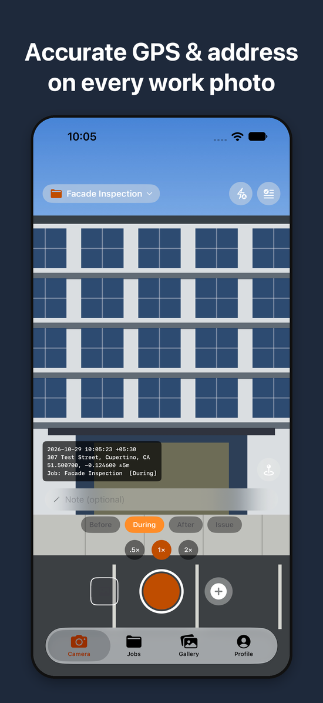
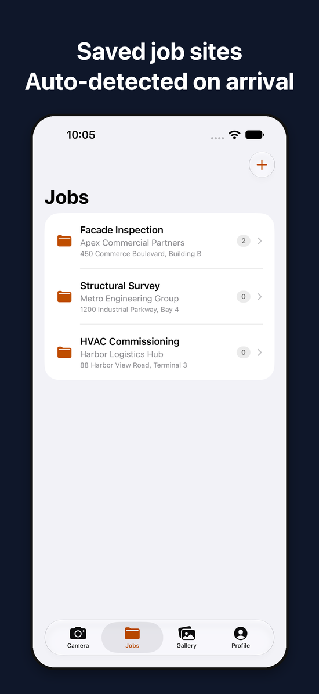
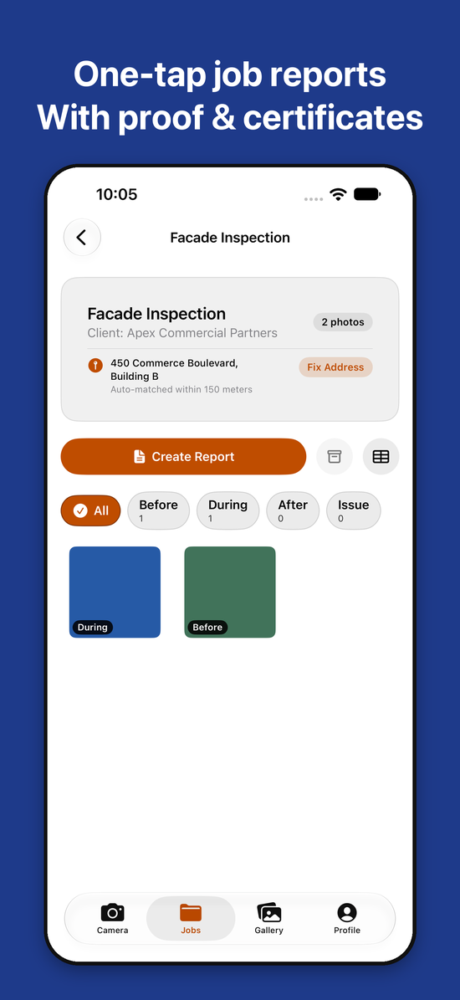

# Shotproof: Work GPS Camera
### Timestamp Photo Proof & Client PDF Reports

Shotproof is the tamper-evident job-site camera built for general contractors, construction trades, surveyors, utility workers, and field inspectors.

Capture proof photos with permanent GPS coordinates, verified street addresses, compass heading, project tags, and timestamps burned directly into every frame.

  <a href="#app-store" style="display: inline-block; background: #111; color: #fff; text-decoration: none; padding: 13px 26px; border-radius: 980px; font-weight: 600; font-size: 16px; border: 1px solid #333; box-shadow: 0 2px 8px rgba(0,0,0,0.15);">
    Download on the App Store ↗
  </a>
  Available on iOS 17+. Link will activate upon App Store release.

  
  
  

Built for high-stakes field compliance: atomic flash memory writes prevent lost photos, and clock-tampering detection protects your proof.

---

## Key Features

### Crash-Proof Local Capture Architecture
Field photos must never be lost. When inspecting foundations, utility trenches, or demolition work, unexpected app crashes or dead batteries cannot wipe evidence:
- **Atomic Disk Writes:** Shotproof commits the raw, full-resolution camera sensor capture to disk before rendering the stamp overlay
- **Fail-Safe Integrity:** Even if your iPhone shuts down mid-capture, the raw photo is preserved and recovered on next launch

### Tamper-Evident Geostamps & Coordinates
- **High-Precision Watermarking:** Burns latitude, longitude, altitude, compass bearing, timestamp, and address directly into the image pixels
- **Network Clock Verification:** Cross-checks your iPhone's clock against official network time servers (NTP) to detect and flag manual device clock adjustments
- **Cryptographic Hashing:** Computes a SHA-256 integrity checksum for each shot

### Offline Geocoding & Verified Job Sites
- **100% Offline Capability:** GPS coordinates, elevation, and compass heading capture seamlessly in rural or subterranean environments
- **Background Address Queue:** When connectivity resumes, reverse geocoding resolves street addresses automatically
- **Verified Job Sites:** Pin specific project boundaries (within 150m) so all photos taken within the perimeter consistently use your official contract address

### Professional Client PDF Reports
- **One-Tap Inspection Sheets:** Export formatted PDF photo sheets featuring photo grids, satellite map thumbnails, timestamp metadata, and inspector notes
- **Company Branding:** Burn your company name, logo, and license numbers onto photo watermarks and report headers
- **Excel & CSV Export:** Download complete photo registers for corporate project management archives

---

## Free vs Shotproof Pro

| Feature | Shotproof Free | Shotproof Pro |
|---|:---:|:---:|
| Photo capture & local storage | Unlimited | Unlimited |
| GPS coordinates, timestamp & address watermarking | Yes | Yes |
| Offline reverse geocoding queue | Yes | Yes |
| Crash-proof atomic write pipeline | Yes | Yes |
| Unlimited PDF job reports with map snapshots | — | Yes |
| Company logo watermarking on photos & reports | — | Yes |
| Unlimited Job Sites and custom project tags | — | Yes |
| CSV / Excel photo register export | — | Yes |
| Independent RFC 3161 timestamp certificates | — | Yes |

*Shotproof Pro is available as an annual subscription with a 1-month free trial or as a monthly plan.*

---

## Frequently Asked Questions

### Does Shotproof work when there is no cell service on site?
Yes. GPS satellite location, device altitude, compass direction, and camera capture operate 100% offline. Shotproof logs the exact coordinates and automatically resolves the human-readable street address as soon as you reconnect to Wi-Fi or cellular service.

### What happens if my phone dies while taking a photo?
Shotproof utilizes an atomic write pipeline: the raw sensor capture is flushed to permanent flash memory before post-processing and watermarking begin. Your photo is safe even if the phone powers down immediately after the shutter clicks.

### Can I include my company's logo on photos and reports?
Yes. Shotproof Pro allows you to upload your company logo and customize whether it appears on individual photo watermarks, formal PDF report headers, or both.

### How does Shotproof detect device clock tampering?
Shotproof queries standard network time servers to verify true UTC time whenever network access is available. If an iPhone's internal clock has been manually altered to backdate photos, Shotproof flags the clock discrepancy in the metadata report.

### Can I organize photos by project or job site?
Yes. You can create distinct Job Sites (e.g. "742 Evergreen Terrace Remodel" or "Pier 14 Structural Inspection"). All photos taken for that project stay neatly organized with dedicated tags and exportable report packages.

---

## Documentation & Support
- [Privacy Policy](privacy/)
- [Support & FAQ](support/)
- **Contact:** [shubhamn910@gmail.com](mailto:shubhamn910@gmail.com)
