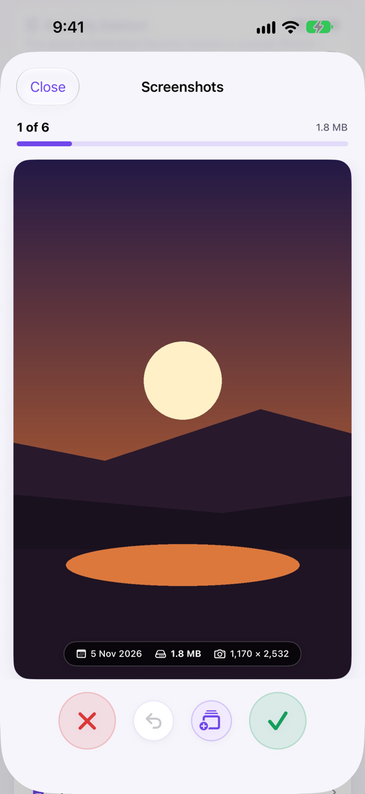
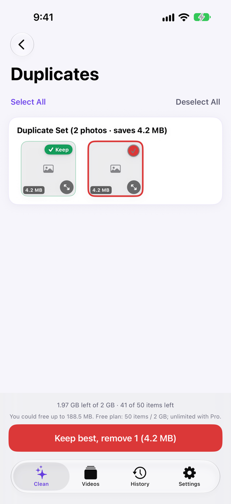
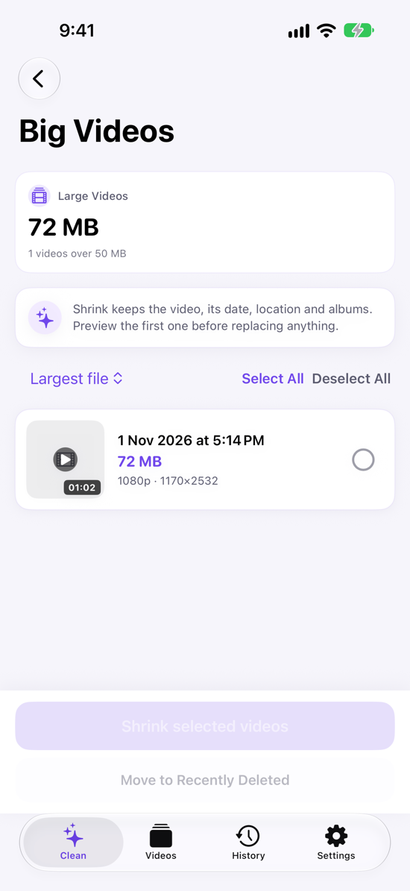

# Shrinkwise: Video Compressor
### Shrink large videos, swipe-clean your camera roll, and free up space

Shrinkwise is an on-device video compressor and swipe cleaner for iPhone and iPad. Compress large videos with the iPhone's hardware video encoder, keeping the date, location, favorites and albums. Then swipe through your camera roll to delete duplicates, similar photos, screenshots and blurry shots, and see exactly how much space you free.

  
    Coming soon to the App Store
  
  For iPhone and iPad with iOS 17 or later. The link will appear when the app is released.

  
  
  

Everything runs on your device. Nothing is uploaded.

---

## Key Features

### Swipe Review for Photos
Go through your photos one by one with card gestures:
- **Swipe Left to Trash, Swipe Right to Keep:** Quickly review hundreds of photos in minutes.
- **Undo Anytime:** Changed your mind? One tap undoes your last swipe immediately.
- **Safety Staging:** Photos marked for removal remain staged in a review queue until you tap Confirm Deletion.

### Screenshots & Blurry Photo Cleanup
- **Screenshots Detection:** Automatically isolates old receipts, temporary QR codes, and forgotten screen grabs.
- **Blurry Photo Recognition:** Analyzes image sharpness and focus to identify accidental, out-of-focus shots cluttering your library.

### Live Photos to Still Photo Converter
Every Live Photo stores both a high-resolution still image and a hidden 3-second .mov video clip:
- **Massive Space Savings:** Converting Live Photos to stills removes the underlying 3-second motion video while preserving the bit-for-bit still photo.
- **Album Preservation:** Shrinkwise verifies album membership and retains your photo in every user album it originally belonged to before removing the heavy motion clip.
- **Full Metadata Retention:** Creation dates, locations, and favorites are preserved without alteration.

### Hardware-Accelerated HEVC Video Compression
- **Apple Silicon Media Engines:** Transcodes heavy 4K and 1080p videos using dedicated hardware HEVC (H.265) and H.264 encoders.
- **Safe on Battery:** Compression pauses when the battery is below 20% and the device is not charging, and the optional overnight mode only runs while charging.
- **Frame-Sampled SSIM Quality Verification:** In "Keep Quality" mode, Shrinkwise computes structural similarity (SSIM) across sample frames, verifying that even the worst 1% of frames maintain a visual fidelity index ≥ 0.98. If a file cannot be compressed without visible degradation, Shrinkwise preserves your original.

### Exact Duplicates & Similar Photos
- **Exact Duplicates:** Matched by content data hash and Vision feature-print distance (near zero), never file size or pixel dimensions alone.
- **Similar Photos:** Perceptual clustering identifies burst shots and slight variations so you can keep the best one.

### Contacts Cleanup (optional)
- Find duplicate and empty contacts and merge or delete them. Contacts are processed on your device.

### Facts-Only iCloud Storage Estimates
- Clear, factual comparisons between your photo library size and Apple's standard storage tiers (50 GB, 200 GB, and 2 TB).
- No guesses about your current iCloud plan, no currency estimates—just straightforward gigabyte math.

### Safe Reclamation Pipeline
- **Recently Deleted Safety Net:** All deletions are executed via Apple PhotoKit, sending originals to your Photos "Recently Deleted" album where they remain safe and recoverable for 30 days.

---

## Free vs Shrinkwise Pro

| Feature | Shrinkwise Free | Shrinkwise Pro |
|---|:---:|:---:|
| Photo library scan & storage breakdown | Yes | Yes |
| Swipe photo review | Yes | Yes |
| Exact duplicates & similar photos detection | Yes | Yes |
| Blurry photos & screenshots detection | Yes | Yes |
| Live Photo to still conversion with album preservation | Yes | Yes |
| Facts-only iCloud storage estimates | Yes | Yes |
| Video compression in Keep quality mode (frame-checked) | Yes | Yes |
| Cleaning and shrinking allowance | First 2 GB and 50 items | Unlimited |
| Balanced and Max space video modes | — | Yes |
| Overnight compression while charging | — | Yes |
| Bulk iCloud downloads | — | Yes |

*Shrinkwise Pro is available as a monthly or yearly subscription with no free trial. The free tier is the trial. Cancel anytime in Apple Settings.*

---

## Frequently Asked Questions

### How does Swipe Review work?
Swipe Review lets you go through your photos one by one. Swipe left to stage a photo for deletion, or swipe right to keep it. Nothing is deleted from your device until you review your staged queue and tap Confirm Deletion.

### What happens when I convert a Live Photo to a still photo?
A Live Photo combines a still JPEG/HEIC image with a 3-second companion video file. Shrinkwise extracts the original full-resolution still frame, adds it to all existing albums the Live Photo belonged to, and moves the heavy Live Photo to your Recently Deleted album.

### How does Shrinkwise detect exact duplicates?
Unlike utilities that guess based solely on filename or byte count, Shrinkwise inspects file content hashes and Vision feature-print distances to verify that two photos are genuinely identical before grouping them.

### Can I recover deleted photos or videos?
Yes. Deletions are performed via Apple PhotoKit, which moves originals to the "Recently Deleted" album in your Photos app where they remain recoverable for 30 days.

### Are my photos or videos uploaded to a server?
Never. All scanning, feature hashing, image analysis, and video compression occur strictly on your device using Apple Silicon hardware.

---

## Documentation & Support
- [Privacy Policy](privacy/)
- [Support & FAQ](support/)
- **Contact:** [shubhamn910@gmail.com](mailto:shubhamn910@gmail.com)
